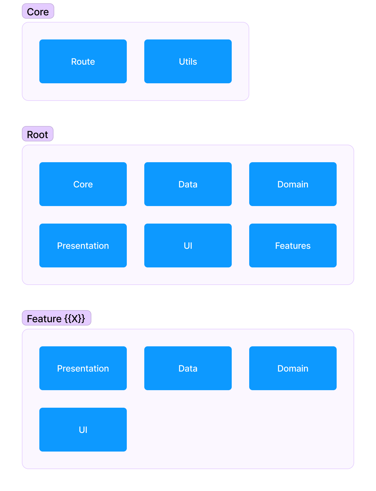
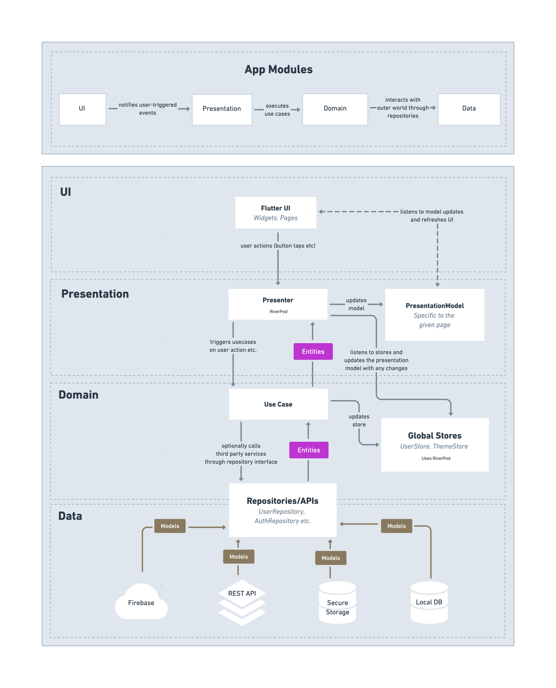
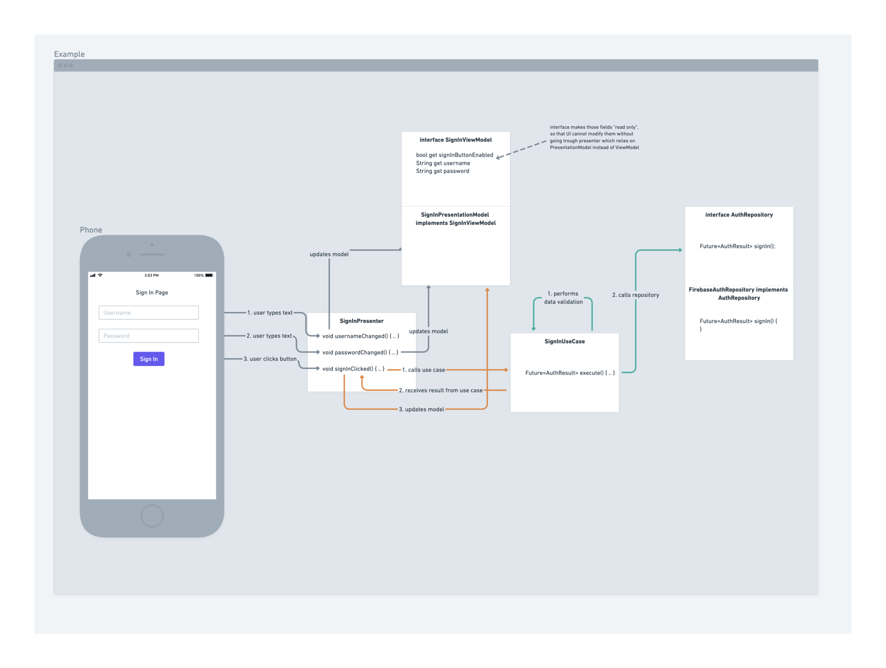

# So Like App: Base Project

Base Project with the aim of making processes like rapid application development and maintenance easier, shortening application processes, and automating them.

## File and Project Structure of So Like App Base Project

Main structure of base project

##### Root

Core, Data, Domain, Presentation and UI folder is shared with features.

- Core
  - Route
  - Utils
- Data
  - Repositories
- Domain
  - Entites
  - Stores
  - Use Cases
- Features
  - X
    - Same files of root files
- Presentation
  - Entities
  - Model
  - Presenters
- UI

##### Features

Think of the feature folder as a bundle. Why do we need all the files from the root folder for each feature? In the future, we might want to export a feature to another project. If we separate the feature files into their respective root folders, exporting a feature will take more time, as we would need to separate each feature folder from other folders. However, if we keep the folders separate, the export process for each feature will only take a few minutes. This way, we can save more time.

#### TO-DO

- Staging [X]
  - Test [X]
  - Beta [X]
  - Prod [X]
- CLI []
  - Create a feature []
  - Create a repository []
  - Create a UI (Page, some widget etc..) []
  - Create a database (Secure or local) []
  - Package name changer []
- FlutKit Integration [X]
- Local Notification Integration (Code base and use case etc..) []
- Shorebird Module []
- Auth Module []
- Firebase Module [/] (Staging level integration completed)
